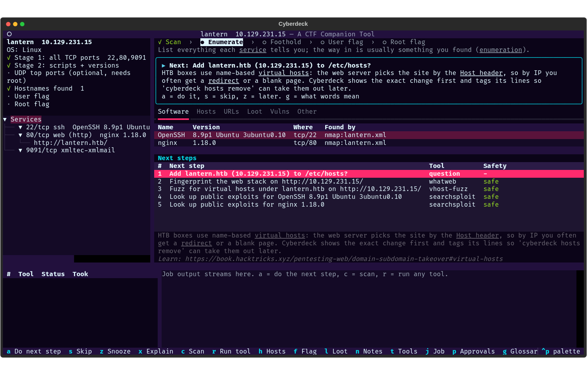
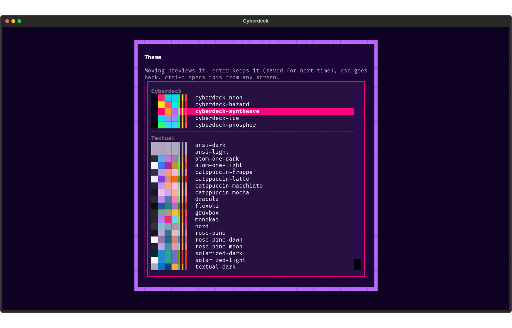

<div align="center">

<picture>
  <source media="(prefers-color-scheme: dark)" srcset="assets/logo-dark.png">
  
</picture>

**A companion for working Hack The Box machines from Kali Linux.**

It tracks your progress on each box, suggests what to run next (and *why*), and wraps the
Kali tools so every command is explained and every result is kept. You still do the hacking.




</div>

> [!NOTE]
> Cyberdeck is in early, active development. It works end to end on real boxes, but expect
> rough edges and changes between versions.

## What it is (and isn't)

Cyberdeck is **not** an autopilot. It doesn't exploit boxes or chase flags for you. It's the
notebook, checklist and tool launcher that sits next to your own terminal and browser:

- **It tracks the box.** Ports, services, versions, hostnames, URLs, users, credentials,
  hashes, flags, notes and every command run, all in the box's folder. Progress (scanned,
  enumerated, foothold, user, root) comes from that record, so you can stop and resume any time.
- **It suggests next steps.** From what's known so far, it ranks what's worth trying next and
  explains why, with a link to learn more. You decide what to run; you can skip or snooze
  any suggestion.
- **It wraps the tools.** nmap, feroxbuster, ffuf, netexec, smbmap, hashcat, searchsploit and
  40 more run through a Run dialog with presets, explained flags and a preview of the exact
  command. Their output is saved and parsed into findings.

**A lot of the work still happens outside it**, as it should: reading the site in your
browser, Burp, poking at a login form, catching a reverse shell, enumerating as a user,
privilege escalation. Bring what you learn back into Cyberdeck yourself:

- add credentials, users and hashes you found by hand in **Loot** (`l`, then `a`), and record
  flags with `f`
- keep free-form notes in the box's `notes.md` (`n`)
- tick checklist items you did by hand (`k`), add hostnames (`cyberdeck hosts add <name>`), or
  import an nmap scan you ran yourself (`cyberdeck import`)

The suggestions use whatever you add, the same as tool output: a password you typed in can
prompt "try it on SMB" or, on Active Directory, a Kerberoast.

## Features

| Feature | What it does |
|---|---|
| **Guided recon** | New-box wizard, HTB VPN check, two-stage nmap (all ports, then scripts and versions on the open ones), each run approved by you and imported automatically. |
| **Tool plugins** | 45+ Kali tools described in YAML: web, SMB/AD, RPC, creds, forensics, exploit research. Add your own without writing Python. |
| **Next-step suggestions** | Rules turn findings into ranked next steps with a *why*. They cover fingerprinting a site, adding vhosts to `/etc/hosts` (diff shown first), fuzzing, SMB/AD enumeration and exploit lookups. |
| **Per-box findings store** | Services, versions, hostnames, URLs, users, credentials, hashes and flags, from tool output or added by you, each with where it came from. Secrets are masked in the UI. |
| **TUI and browser UI** | A keyboard-driven Textual dashboard. `cyberdeck --web` serves the same UI in your browser. |
| **Learning aids** | Beginner layout with a journey bar, plain-English job summaries, a glossary, per-service checklists, a graded "I'm stuck" flow and a rabbit-hole timer. |
| **Journal and write-ups** | The box's story builds itself from what you did. Draft a write-up (loot and your paths masked), then read and edit it in the app. |
| **Claude Code over MCP** | `cyberdeck mcp` lets Claude Code read findings, preview commands and run safe tools. Anything riskier waits for your approval. |
| **Cyberpunk themes** | Five neon palettes plus every Textual theme. `ctrl+t` switches theme from any screen, with live preview. |

<div align="center">



</div>

## Requirements

- **Kali Linux** (or another Linux with the tools you want installed)
- **Python 3.11+** and [uv](https://docs.astral.sh/uv/)
- **nmap**, plus whichever Kali tools you want Cyberdeck to drive. It detects what's installed
  and only offers those. `cyberdeck doctor` tells you what's missing and how to fix it.
- A Hack The Box VPN connection (`.ovpn`) for HTB targets

## Install

```bash
curl -LsSf https://astral.sh/uv/install.sh | sh        # install uv (once)
git clone https://github.com/DanDreadless/cyberdeck.git
cd cyberdeck
mkdir -p ~/.config/cyberdeck && cp .env.example ~/.config/cyberdeck/.env   # your settings
uv tool install -e .              # puts `cyberdeck` on your PATH
uv tool install -e ".[web]"       # ...or with the browser UI
```

## Quick start

```bash
cyberdeck doctor                  # check VPN, tools, wordlists, sudo and clock; shows fixes
cyberdeck                         # open the TUI
```

In the TUI, press `n` for a new box and give it a name and IP. Cyberdeck checks that the box is
routed through your VPN, then offers the nmap stages (you approve each one in the Run dialog).
From there, work the box as usual and use the dashboard to keep track and decide what's next:

| Key | Does |
|---|---|
| `a` / `enter` | Do the top suggested next step |
| `r` | Run any tool |
| `c` | Scan (nmap stages, UDP) |
| `h` | Add the box's hostnames to `/etc/hosts` (diff, confirm, sudo) |
| `l` / `n` / `W` | Loot (add creds, users, hashes by hand with `a`), notes, write-up |
| `k` / `!` | Methodology checklist / "I'm stuck" |
| `f` | Record a flag |
| `ctrl+t` | Change theme |
| `?` / `ctrl+p` | Every key on this screen / search all actions |

Prefer the command line? Everything works there too:

```bash
cyberdeck new soccer --ip 10.129.x.x    # create the box, check the VPN, scan
cyberdeck suggest                       # next steps, with why
cyberdeck suggest run 1                 # run one (through the Run dialog)
cyberdeck show                          # services, versions, hostnames
```

<details>
<summary><b>Full command reference</b></summary>

```bash
# Boxes
cyberdeck new                               # wizard: name, IP, folder -> VPN check -> both nmap stages
cyberdeck new soccer --ip 10.129.x.x --yes  # same, no questions, default options
cyberdeck new soccer --ip 10.129.x.x --no-scan   # just create (or adopt an existing folder)
cyberdeck list                              # boxes, last opened first, with progress
cyberdeck resume soccer                     # make it current, show progress, offer the next step
cyberdeck status                            # what's done / interrupted / next for the current box
cyberdeck use soccer                        # set the current box (used outside box folders)
cyberdeck set-ip 10.129.x.y                 # HTB re-spawned the box; offers to move its hosts line
cyberdeck vpn                               # tunnel, LHOST, and whether the box is routed via it

# Scanning and tools
cyberdeck scan                              # both nmap stages via the Run dialog
cyberdeck scan -s 1 -p reliable             # stage 1 only, gentler preset for flaky VPNs
cyberdeck scan -s udp --sudo                # UDP top ports (needs root)
cyberdeck scan --yes -- --max-rtt-timeout 500ms   # no dialog; extra args after --
cyberdeck import [path]                     # import nmap results you ran yourself
cyberdeck run list                          # tools Cyberdeck can run, with group and safety tag
cyberdeck run whatweb                       # one tool through the Run dialog (URL filled in)
cyberdeck run dir-bruteforce -p quick       # your preferred of feroxbuster/gobuster/dirsearch
cyberdeck run feroxbuster --opt depth=3 -- --dont-filter
cyberdeck reparse 5                         # parse job 5's saved output again
cyberdeck jobs                              # every command run against the box
cyberdeck job 2 [--err] [--tail 0]          # one job's exact command and output

# Suggestions
cyberdeck suggest                           # next steps, highest priority first, with why
cyberdeck suggest run 3                     # open #3 in the Run dialog, or answer its question
cyberdeck suggest skip 3 / snooze 3 / reopen 3
cyberdeck auto                              # work through the safe suggestions
cyberdeck auto --dont-ask --rounds 2        # no dialog for safe tools (commands still printed)

# /etc/hosts
cyberdeck hosts                             # this box's hosts line(s) and unmapped names
cyberdeck hosts add [name]                  # add the box's hostnames: diff, confirm, sudo
cyberdeck hosts remove [--all]              # take Cyberdeck's lines out again

# Findings and loot
cyberdeck show                              # services, versions, hostnames, OS
cyberdeck flag user <flag>                  # record flags (progress tracks them)

# Learning
cyberdeck doctor [--create-folder]          # setup check with fixes
cyberdeck glossary [term]                   # plain-word meaning of vhost, LHOST, SUID...
cyberdeck checklist [--all]                 # what to check on this box, per service and phase
cyberdeck checklist done web.robots         # tick an item (na = doesn't apply, reset = open again)
cyberdeck stuck [--hint]                    # what you haven't tried yet; --hint adds general hints
cyberdeck lead start "the /upload page"     # rabbit-hole timer; park / done / resume
cyberdeck journal                           # the box's story
cyberdeck lesson [--kind user|root|note]    # what you learned
cyberdeck writeup [-o file] [--stdout] [--reveal] [--force]   # Markdown write-up, loot masked
cyberdeck playbook [search]                 # your lessons from every box
cyberdeck path / cyberdeck skills           # suggested boxes in order, techniques practised

# Tools
cyberdeck tools                             # installed tools, versions, group picks, problems
cyberdeck tools detect                      # re-check after installing something
cyberdeck tools prefer gobuster-dir         # use gobuster for dir-bruteforce
cyberdeck tools disable nikto               # keep a tool out of groups and suggestions
cyberdeck tools help ffuf-vhost             # the tool's own --help
cyberdeck tools wordlists                   # named wordlists and whether they exist
cyberdeck tools check plugins/tools/web/x.yaml   # validate a tool profile you're writing

# UI and MCP
cyberdeck tui -t soccer                     # straight to a box's dashboard
cyberdeck --web                             # the UI in your browser on 127.0.0.1:8000
cyberdeck mcp -t soccer                     # MCP server for Claude Code (stdio; --http for HTTP)
cyberdeck approvals [--all]                 # MCP requests waiting for you; approve <#> / deny <#>
```

Which box a command acts on: `-t <box>`, else the box folder you're in, else the current box
(`cyberdeck use`).

</details>

## How it works

1. **A folder per box.** `cyberdeck new` creates `<workspace>/<box>/` with `nmap/`, `raw/`,
   `loot/`, `notes.md`, `target.db` and `target.yaml`. Everything about the box lives there.
   There's no global database, so boxes are independent and easy to back up or delete.
2. **Scan.** Stage 1 finds all open TCP ports fast. Stage 2 runs `-sC -sV` on exactly those
   ports. You approve each stage in the Run dialog, and the results are imported automatically.
3. **Run tools when you choose to.** Each tool is a YAML manifest. Its inputs (URL, domain,
   wordlist) are pre-filled from what's been found, you check the command, and its output is
   parsed into findings: URLs, versions, hostnames, users, credentials.
4. **Add what you find yourself.** Creds from a config file you read in the browser, a user
   from a shell, a flag: put them in Loot, notes or the flag prompt, and they count like
   anything a tool found.
5. **Get suggestions.** After every change, rules look at what's known and rank the next
   moves, with a *why*. They're suggestions: run one, skip it, or do something else entirely.
   If you want, `cyberdeck auto` can chain the **safe** recon ones (each shown first). Anything
   tagged intrusive, brute-force or exploit only ever runs when you confirm it.
6. **Learn as you go.** Job summaries, the checklist, the "I'm stuck" hints and the questions
   asked when you capture a flag build a journal per box and a playbook across boxes.

## Claude Code (MCP)

```bash
claude mcp add cyberdeck -- cyberdeck mcp -t soccer
```

Claude Code can then read the box's findings and suggestions, preview commands and run **safe**
tools. You see the exact command first. Intrusive tools, anything needing sudo and every
`/etc/hosts` edit wait in an approvals queue (`p` in the TUI, or `cyberdeck approvals`), and
there's no setting to skip that. Passwords, hashes and flags are masked before they reach the
model. For a remote client, `cyberdeck mcp --http 127.0.0.1:8765` serves over HTTP with a bearer
token (`CYBERDECK_MCP_TOKEN` in `.env`); reach it through an SSH tunnel.

## Adding a tool

Copy [`plugins/tools/_template.yaml`](plugins/tools/_template.yaml) into a category folder (or
`~/.config/cyberdeck/plugins/tools/`), fill it in, and validate it:

```bash
cyberdeck tools check ~/.config/cyberdeck/plugins/tools/web/mytool.yaml
```

The template's comments explain each field. [`plugins/tools/README.md`](plugins/tools/README.md)
covers the conventions, and the existing manifests are working examples. Suggestion rules
(`rules/`) and learning content (`learn/`) can be overridden the same way, from
`~/.config/cyberdeck/`.

## Configuration

Settings live in `~/.config/cyberdeck/.env` (or `./.env`, both gitignored). `.env.example` lists
every variable with a comment. The main ones:

| Variable | What |
|---|---|
| `CYBERDECK_WORKSPACE_ROOT` | Where box folders go (default `~/Documents/htb`) |
| `CYBERDECK_VPN_DIR` / `CYBERDECK_VPN_CONFIG` | The folder with your HTB `.ovpn` files / one specific file |
| `CYBERDECK_SCOPE_EXTRA` | Extra targets to allow, beyond the HTB ranges |
| `CYBERDECK_MCP_TOKEN` | Bearer token for `cyberdeck mcp --http` |

Preferences (layout, theme, learning aids, tool choices) are set in the TUI's Settings screen
(`,`) and saved to `~/.config/cyberdeck/config.yaml`.

## Safety

> [!WARNING]
> Only use Cyberdeck against systems you are authorised to test, such as Hack The Box labs.

- A **scope guard** checks every job's target. Only the HTB lab ranges (`10.10.0.0/16`,
  `10.129.0.0/16`) are allowed by default. Anything else must be added explicitly with
  `CYBERDECK_SCOPE_EXTRA`.
- Nothing intrusive, brute-force or exploit-tagged ever runs without your explicit
  confirmation, including when Claude Code is driving.
- `/etc/hosts` changes are shown as a diff, need your sudo password, and are tagged so
  `cyberdeck hosts remove` can cleanly undo them.
- Loot (credentials, hashes, flags) stays in the box folder, is masked in the UI and in
  write-ups, and is never written to global logs.

## Development

```bash
uv sync                                      # .venv + dev dependencies from uv.lock
uv run pytest                                # tests (no Kali tools, network or VPN needed)
uv run ruff check . && uv run ruff format .  # lint + format
uv run mypy src                              # strict type checks
```

Tests use fixtures, a fake nmap and a fake tool, so they never touch the network. A hygiene test
fails if your login name or home path ends up in a committed file.

## License

[MIT](LICENSE)
